# Campus Network Design and Implementation Using Cisco Packet Tracer

## Project Overview

This project simulates a campus network connecting the **Main Academic Building** and the **Innovation Lab** through a central router, with connectivity to an ISP network. The goal is to build a manageable network that separates departments, automatically assigns IP addresses to lab computers, provides centralized services, routes traffic between buildings, controls access, and supports external access to a hosted website.

**Platform:** Cisco Packet Tracer  
**Routing protocol:** OSPF  
**Key technologies:** VLANs, 802.1Q trunks, router-on-a-stick, DHCP relay, DNS, HTTP, FTP, email services, NAT, PAT, and extended ACLs

## At a glance

| | |
|---|---|
| **Devices** | 4 routers (Main, Central, Innovation, ISP), Catalyst 2960 switches, 6 VLANs, 4 servers, external test PC |
| **Services** | DHCP + relay, DNS, HTTP, FTP, email |
| **Routing** | OSPF between campus routers; default route to ISP |
| **Security** | Extended ACL on the Administration VLAN; NAT/PAT at the edge |
| **Project file** | [`packet-tracer/campus-network-packet-tracer.pkt`](packet-tracer/campus-network-packet-tracer.pkt) (open with Cisco Packet Tracer) |
| **Full addressing** | [`docs/addressing-plan.md`](docs/addressing-plan.md) |

## Contents

1. [Network architecture](#1-network-architecture)
2. [IP addressing and VLAN plan](#2-ip-addressing-and-vlan-plan)
3. [VLANs, trunking and inter-VLAN routing](#3-vlans-trunking-and-inter-vlan-routing)
4. [Dynamic routing with OSPF](#4-dynamic-routing-with-ospf)
5. [Centralized DHCP and relay](#5-centralized-dhcp-and-dhcp-relay)
6. [Server room and services](#6-server-room-and-network-services)
7. [NAT and PAT](#7-internet-connectivity-nat-and-pat)
8. [Administration ACL](#8-administration-vlan-security-with-an-extended-acl)
9. [Testing checklist](#9-testing-and-verification-checklist)
10. [Troubleshooting and lessons learned](#10-troubleshooting-and-lessons-learned)
11. [Potential improvements](#11-potential-improvements)
12. [Repository structure](#12-repository-structure)

## How to use this repo

1. Install Cisco Packet Tracer and open the `.pkt` file in `packet-tracer/`.
2. Open a router CLI and run the commands listed under each **Verification** heading.
3. Compare your output with the screenshots in `screenshots/`.

## 1. Network Architecture

The network has four major parts:

1. **Main Academic Building:** Administration, Accounts, Faculty, Student Lab, and Server Room, each in a separate VLAN.
2. **Innovation Lab:** A separate lab network in VLAN 60.
3. **Central Router:** Connects both buildings to the ISP, hosts the DHCP pools, and performs NAT/PAT.
4. **ISP and External PC:** Simulate a user outside the campus accessing the published website.

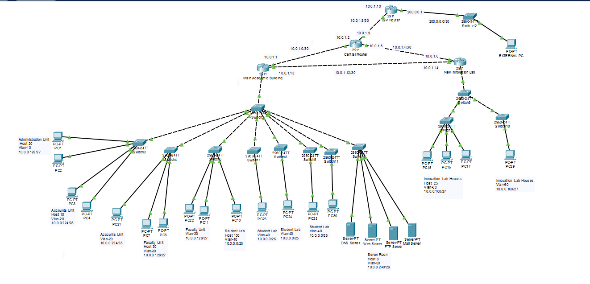

*Figure 1: Complete logical network topology.*

Simplified view of the router links (each link is a /30):

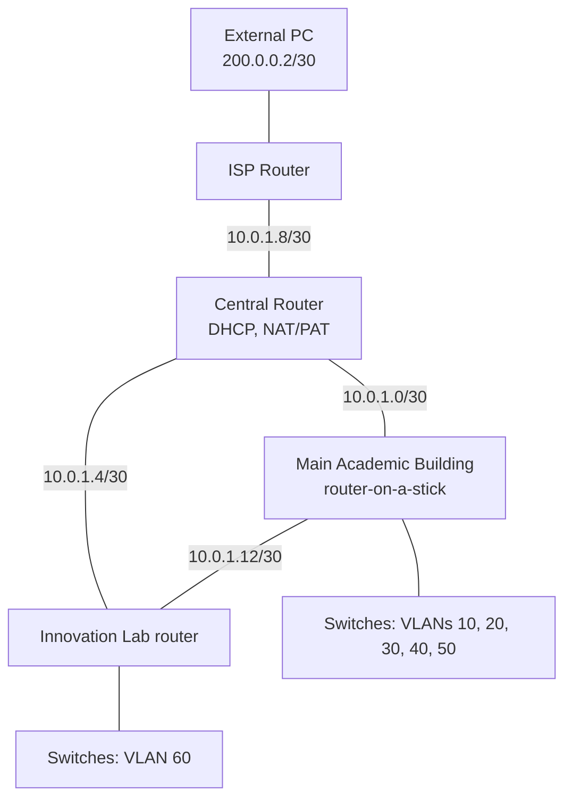

### Why this architecture?

Separating users into VLANs reduces unnecessary broadcast traffic and creates logical boundaries between departments. Routers provide controlled communication across those boundaries. A central router consolidates shared services such as DHCP and internet translation, while OSPF allows routers to learn campus routes dynamically.

## 2. IP Addressing and VLAN Plan

| VLAN | Department / Network | Subnet | Default Gateway | Addressing |
|---|---|---|---|---|
| 10 | Administration | `10.0.0.192/27` | `10.0.0.193` | DHCP |
| 20 | Accounts Unit | `10.0.0.224/28` | `10.0.0.225` | DHCP |
| 30 | Faculty | `10.0.0.128/27` | `10.0.0.129` | DHCP |
| 40 | Student Lab | `10.0.0.0/25` | `10.0.0.1` | DHCP |
| 50 | Server Room | `10.0.0.240/28` | `10.0.0.241` | Static |
| 60 | Innovation Lab | `10.0.0.160/27` | `10.0.0.161` | DHCP |

Different subnet sizes reflect different capacity requirements. Student Lab uses a `/25` network for more devices, whereas smaller departments use `/27` or `/28` networks.

**Verification:** `show vlan brief`, `show interfaces trunk`, and host IP configuration.

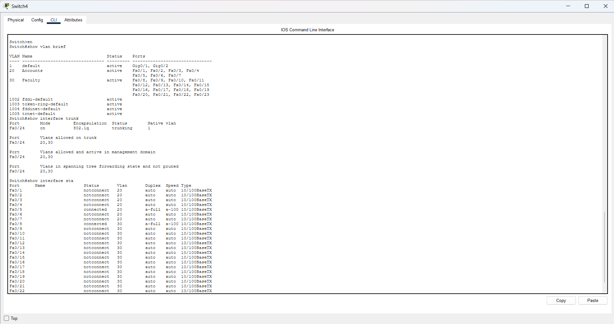

## 3. VLANs, Trunking, and Inter-VLAN Routing

### What I configured

Department-facing switch ports are assigned to their respective VLANs. Uplink ports use **802.1Q trunks** to carry multiple VLANs. The Main Academic Building router uses subinterfaces for router-on-a-stick routing:

| Router interface | IP address | Purpose |
|---|---|---|
| `G0/0.10` | `10.0.0.193` | Administration gateway |
| `G0/0.20` | `10.0.0.225` | Accounts gateway |
| `G0/0.30` | `10.0.0.129` | Faculty gateway |
| `G0/0.40` | `10.0.0.1` | Student Lab gateway |
| `G0/0.50` | `10.0.0.241` | Server Room gateway |
| `G0/1` | `10.0.1.1` | Connection toward Central Router |
| `G0/2` | `10.0.1.13` | Connection toward Innovation Router |

The Innovation router uses `G0/1.60` (`10.0.0.161`) as the gateway for VLAN 60. Its other routed interfaces connect to Central (`10.0.1.6`) and Main (`10.0.1.14`).

### Why?

Devices in different VLANs cannot communicate directly at Layer 2. Router subinterfaces act as gateways and route packets between the VLAN subnets, while trunking avoids the need for a separate physical router connection per VLAN.

**Verification:** `show interfaces trunk`, `show ip interface brief`, and cross-VLAN ping tests.

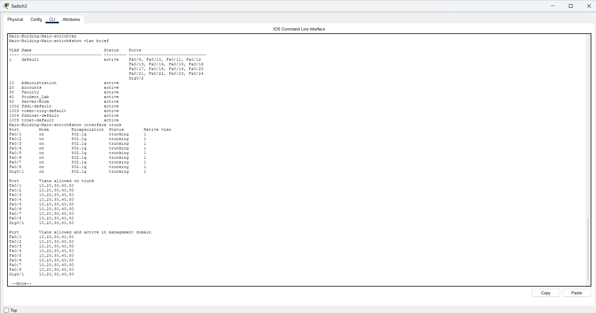

## 4. Dynamic Routing with OSPF

### What I configured

OSPF advertises the campus networks between the Main Academic, Innovation, and Central routers. The links between these routers provide alternative connectivity within the campus topology.

The Central Router has a default route toward the ISP at `10.0.1.10` and advertises the default route to internal OSPF routers using:

```cisco
router ospf 1
 default-information originate
```

### Why?

OSPF reduces the need to manually maintain static routes between campus networks. It also allows routers to update their routing information when network paths change, subject to the configured topology and OSPF behavior.

**Verification:**

```cisco
show ip ospf neighbor
show ip route
```

Check that expected neighbors are in the **FULL** state and that remote networks are learned through OSPF.

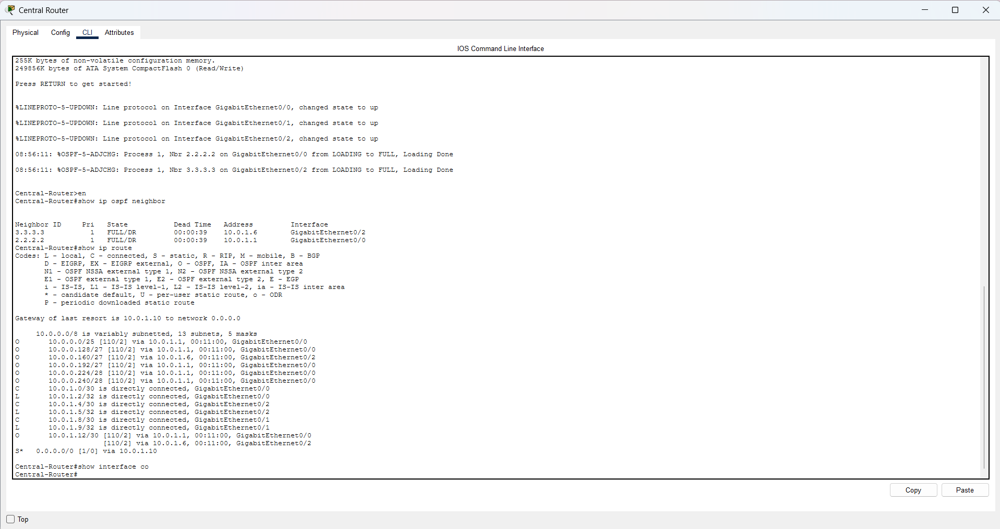

## 5. Centralized DHCP and DHCP Relay

### What I configured

DHCP pools reside on the **Central Router** for every DHCP-addressed VLAN (the Server Room is static):

| Pool | VLAN | Network | Gateway |
|---|---|---|---|
| Student_Lab | 40 | `10.0.0.0/25` | `10.0.0.1` |
| Administration | 10 | `10.0.0.192/27` | `10.0.0.193` |
| Accounts | 20 | `10.0.0.224/28` | `10.0.0.225` |
| Faculty | 30 | `10.0.0.128/27` | `10.0.0.129` |
| Innovation Lab | 60 | `10.0.0.160/27` | `10.0.0.161` |

The Main router's Student Lab interface relays DHCP requests toward Central (the Administration, Accounts and Faculty gateways need the same relay pattern; confirm with `show running-config`):

```cisco
interface GigabitEthernet0/0.40
 ip helper-address 10.0.1.2
```

The Innovation router relays DHCP requests similarly:

```cisco
interface GigabitEthernet0/1.60
 ip helper-address 10.0.1.5
```

### Why?

DHCP automates IP assignment for lab computers. Because DHCP broadcasts do not normally cross routers, `ip helper-address` forwards client requests to the centralized DHCP server. Static addressing is used for servers and selected administrative devices so their addresses remain predictable.

**Verification:** `show ip dhcp binding` and `show ip dhcp pool` on Central, plus `ipconfig` on DHCP clients.

> **Evidence note:** The screenshot below shows the Administration pool with 0 leased addresses. If it was taken before the VLAN 10 DHCP fix, retake it after the Administration PCs have renewed their leases, so the evidence shows all pools in use.

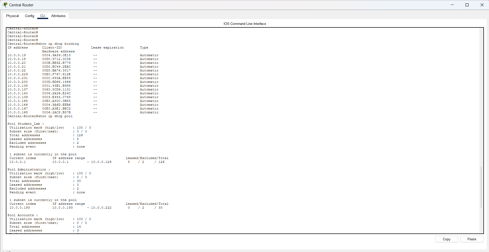

## 6. Server Room and Network Services

The Server Room is in **VLAN 50**, with gateway `10.0.0.241`.

| Service | Private IP | Purpose |
|---|---|---|
| DNS | `10.0.0.242` | Resolves domain names to IP addresses |
| HTTP / Web | `10.0.0.243` | Hosts the campus website |
| FTP | `10.0.0.244` | Demonstrates file transfer service |
| Email | `10.0.0.245` | Provides mail service in the simulation |

### Why?

Centralizing services in a dedicated VLAN makes them easier to locate, manage, and protect. DNS allows clients to use a name instead of remembering an IP address. HTTP delivers web pages, FTP supports file transfer, and the mail server demonstrates application-level communication.

For external web access, the DNS A record for `www.mostafa.com` points to `203.0.113.3`, the simulated public address of the web server.

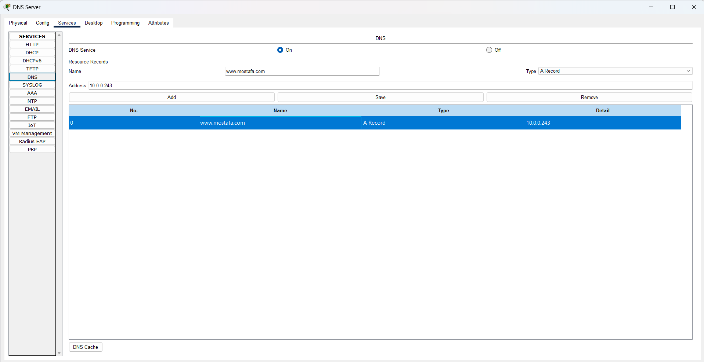
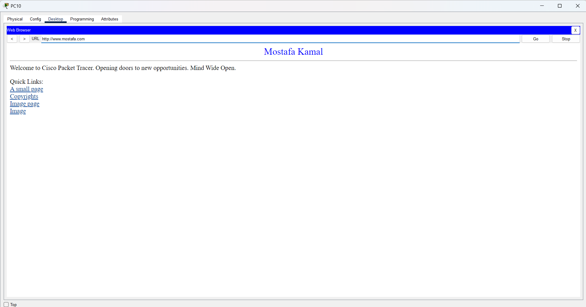

## 7. Internet Connectivity, NAT, and PAT

### Why address translation is necessary

Campus devices use private `10.0.0.0/8` addresses. NAT allows traffic to cross the simulated ISP boundary using addresses associated with the Central Router or its configured public mappings.

### PAT for outbound connections

The Central Router uses **PAT (NAT overload)** so multiple internal clients can share the outside interface address `10.0.1.9` in this simulation:

```cisco
access-list 1 permit 10.0.0.0 0.0.0.255
ip nat inside source list 1 interface GigabitEthernet0/1 overload
```

The `overload` keyword enables PAT. TCP/UDP source ports (or protocol identifiers for other supported traffic) distinguish simultaneous translations.

### Static NAT for externally accessible servers

| Inside local | Inside global | Purpose |
|---|---|---|
| `10.0.0.243` | `203.0.113.3` | Public-facing web server |
| `10.0.0.242` | `203.0.113.4` | Public-facing DNS server |

Example Central Router configuration:

```cisco
ip nat inside source static 10.0.0.243 203.0.113.3
ip nat inside source static 10.0.0.242 203.0.113.4
```

The ISP router has routes toward these translated addresses via `10.0.1.9`. The external test PC uses `200.0.0.2/30`, gateway `200.0.0.1`, and DNS server `203.0.113.4`.

### How an external user opens the website

1. The external PC requests the address of `www.mostafa.com` from DNS at `203.0.113.4`.
2. Static NAT forwards the DNS traffic to the internal DNS server `10.0.0.242`.
3. DNS responds with the website address `203.0.113.3`.
4. The external PC connects to `203.0.113.3`; static NAT forwards the traffic to the internal web server `10.0.0.243`.
5. The web page loads using the domain name.

**Verification:**

```cisco
show running-config | include ip nat
show ip nat translations
show ip nat statistics
```

> **PAT evidence tip:** Generate outbound traffic from two internal clients. In `show ip nat translations`, look for dynamic entries sharing `10.0.1.9` with distinct translated ports/identifiers. Static NAT entries alone do **not** demonstrate PAT.

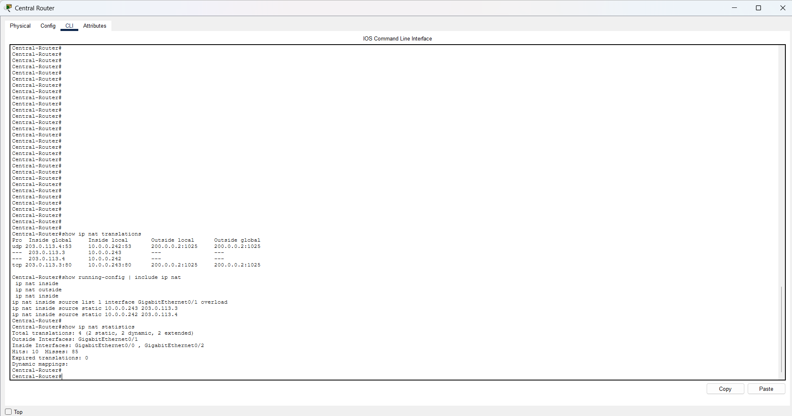
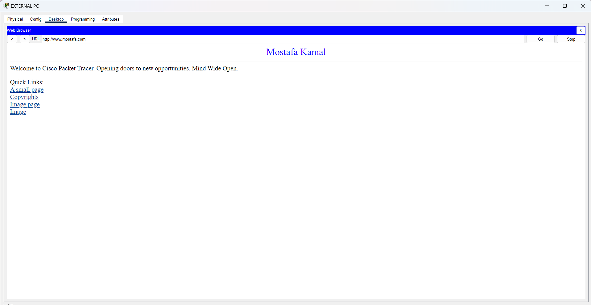

**Addressing note:** `203.0.113.0/24` is documentation address space; it is used here only inside the simulation. The Central Router's outside interface address `10.0.1.9` is also private, so this is a simulated ISP environment rather than a real public internet deployment.

## 8. Administration VLAN Security with an Extended ACL

### What I configured

An extended ACL named `Admin-ACL` is applied **inbound** on the Main Academic router's `G0/0.10` subinterface:

```cisco
ip access-list extended Admin-ACL
 permit udp 10.0.0.192 0.0.0.31 any eq domain
 permit tcp 10.0.0.192 0.0.0.31 any eq domain
 permit tcp 10.0.0.192 0.0.0.31 any eq www
 permit tcp 10.0.0.192 0.0.0.31 any eq 443
 permit tcp 10.0.0.192 0.0.0.31 any eq 22
 permit icmp 10.0.0.192 0.0.0.31 any
 deny ip 10.0.0.192 0.0.0.31 any
!
interface GigabitEthernet0/0.10
 ip access-group Admin-ACL in
```

### Why?

This limits **traffic originating from Administration VLAN 10** as it enters the router. It permits DNS, HTTP, HTTPS, SSH, and ICMP, while blocking other routed IP traffic from that VLAN. For example, FTP to the server at `10.0.0.244` should be denied because FTP control traffic uses TCP port 21, which is not permitted.

**Important scope:** This inbound ACL restricts Administration users' outbound routed traffic; it does **not** by itself block users in other VLANs from initiating connections *toward* Administration. Protecting Administration against incoming access from other departments would require appropriately placed additional ACL rules.

**DHCP and the ACL:** Administration clients use DHCP, and a DHCPDISCOVER leaves the client with source `0.0.0.0`, which does not match `10.0.0.192 0.0.0.31`. An inbound ACL ending in `deny ip ... any` plus the implicit deny can therefore drop it before the relay sees it. If Administration PCs fall back to `169.254.x.x` with this ACL applied, add this line at the top of `Admin-ACL` and re-test:

```cisco
permit udp any eq bootpc any eq bootps
```

**Verification:**

```cisco
show access-lists Admin-ACL
show ip interface GigabitEthernet0/0.10
```

Test a permitted HTTP or DNS request and a denied FTP request from an Administration PC. ACL match counters can provide additional evidence.

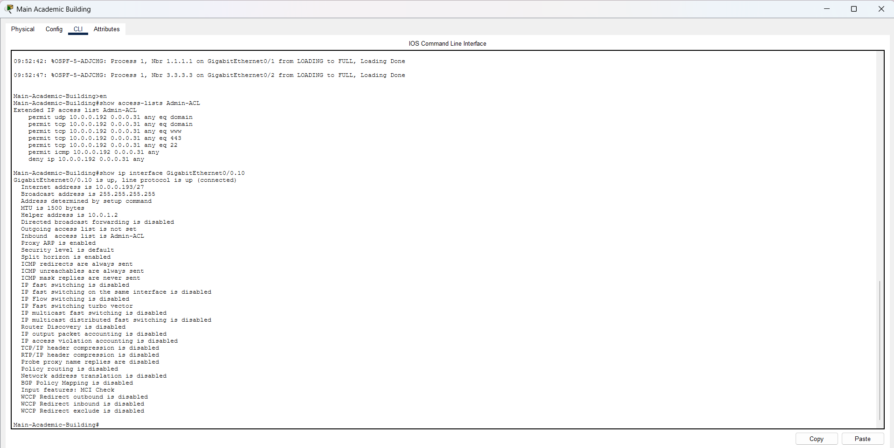

## 9. Testing and Verification Checklist

| Test | Expected outcome | Evidence |
|---|---|---|
| VLAN membership | Ports belong to intended VLANs | `show vlan brief` |
| Trunk links | Required VLANs traverse trunks | `show interfaces trunk` |
| Inter-VLAN routing | Permitted traffic reaches other subnets | Ping / application test |
| OSPF adjacency | Expected neighbors reach FULL state | `show ip ospf neighbor` |
| OSPF routes | Remote networks appear in routing table | `show ip route` |
| DHCP | Lab PCs receive valid addresses | `show ip dhcp binding` / `ipconfig` |
| DNS | Domain resolves to configured IP | DNS client test |
| Internal web service | Campus PC opens hosted site | Browser screenshot |
| PAT | Multiple clients share translated interface address | NAT translations + `overload` config |
| Static NAT | External PC opens `http://www.mostafa.com` | External browser screenshot |
| ACL allowed traffic | Permitted service works | HTTP/DNS test |
| ACL denied traffic | Administration FTP request fails | FTP test + ACL counters |

## 10. Troubleshooting and Lessons Learned

### DHCP requests failing across VLANs

**Issue:** A lab PC may receive a `169.254.x.x` automatic address instead of an address from its assigned subnet.

**Reason:** DHCP discovery is a broadcast and does not cross a router automatically.

**Solution:** Configure `ip helper-address` on the relevant VLAN gateway and confirm the DHCP pool, routing, and interface status.

### Administration VLAN gets no DHCP address

**Issue:** Administration PCs show `169.254.x.x` even though the pool and relay exist, and `show ip dhcp binding` has no `10.0.0.19x` / `10.0.0.20x` entries.

**Check:** the `ip helper-address` on `G0/0.10`, that the Administration pool exists on Central, and whether `Admin-ACL` is dropping the DHCP broadcast (see section 8).

### Public website accessible by IP but not by domain

**Issue:** External access using `http://203.0.113.3` works, but the domain name initially does not.

**Reason:** External DNS must return the translated public-facing address rather than the internal web server address.

**Solution:** Set `www.mostafa.com` to `203.0.113.3` in DNS and set the external PC's DNS server to `203.0.113.4`, with static NAT and ISP routes in place.

### PAT not visible in the translation table

**Issue:** `show ip nat translations` displays static NAT entries but no dynamic PAT entries.

**Explanation:** A PAT configuration is not the same as an active PAT session. Generate traffic from internal clients to an external destination and inspect the translations immediately. Verify the `overload` command and inside/outside interface roles.

### What I learned

- How subnetting and VLANs organize a multi-department campus network.
- How router-on-a-stick and OSPF support communication between different networks.
- Why DHCP relay is required when clients and DHCP servers are separated by routers.
- How DNS, static NAT, and routing work together to publish an internal website.
- The difference between PAT for outbound sessions and static NAT for inbound service access.
- How ACL direction and placement determine which traffic is actually restricted.

## 11. Potential Improvements

- Add targeted ACLs to restrict access **to** Administration from other VLANs.
- Limit management access to SSH from trusted administrator devices.
- Apply switch port security where supported and document verification.
- Add redundant infrastructure and monitoring for higher availability.
- Export each device's `show running-config` into a `configs/` folder so the project can be reviewed without Packet Tracer.
- Use a dedicated public-address plan in a real deployment instead of documentation/private simulation ranges.

## 12. Repository Structure

```text
campus-network-packet-tracer/
├── README.md
├── LICENSE
├── .gitignore
├── docs/
│   └── addressing-plan.md
├── packet-tracer/
│   └── campus-network-packet-tracer.pkt
└── screenshots/
    ├── topology.png
    ├── vlan.png
    ├── inter-vlan.png
    ├── OSPF.png
    ├── dhcp.png
    ├── dns.png
    ├── web.png
    ├── nat-pat.png
    ├── external-web.png
    └── acl.png
```

## 13. Conclusion

This project demonstrates an end-to-end campus network using Cisco Packet Tracer. It combines segmentation, dynamic routing, centralized addressing and services, simulated ISP access, address translation, and traffic filtering. The most important outcome is understanding not only how to configure each feature, but also **why it is needed and how to verify that it works**.

Released under the [MIT License](LICENSE).
